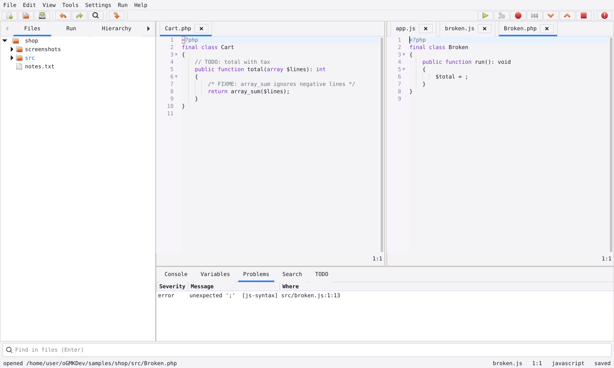

# ogmkdev

## The frame (GTK 4) with the Howl editor

`python3 -m ogmkdev.frame --folder samples/shop [--mode dark --scheme jetbrains] [FILE ...]`

The frame is a GTK 4 window. Its editor areas hold Howl editors: Howl is built as `libhowl.so`
(`packaging/build-howl.sh`) and loaded into the frame's process, so the editor is a GTK widget of the
frame's layout, not a separate window. Details: `howl/OGMKDEV.md`.

- Editor area with panes: split right, down, into four and six; every tab is one Howl editor.
- Howl shows only the editing surface and the cursor position; the colours come from the palettes in
  `ogmkdev/theme.py` (`--mode`, `--scheme`).
- Left: Files, Run configurations, Hierarchy (index), History (local history, patch sets, revert),
  Git (stage, unstage, diff, commit).
- Bottom: Console (run output), Watches, Problems (diagnostics of the open file, inspections of the
  folder), Search (search in files), TODO (TODO words in comments with priorities).
- Tools: go to definition, find implementations, show type hierarchy, inspect folder, refresh and clear
  the index; Search Everywhere and Quick Open.
- Settings > Preferences edits the global settings; the frame is a single window per session: starting it
  again with files hands them to the running frame.

Screenshots (sample data in `samples/shop`):




Open items are listed at the end of this file.


A lightweight code editor written in Python with GTK 4 (PyGObject), with the Howl editor embedded.
The window follows the layout of KDevelop: menu bar, icon toolbar, tool panels around a tabbed
editor, and a status bar. The product is the editor; its base is the KDevelop source tree in
`kdevelop/`, which is rewritten into Python module by module, plus the Python modules in `ogmkdev/`.

Pure source: no build system beyond `pyproject.toml`, no service, no plugin host, no external
grammar or language server. Every language here is implemented in this repository.

## The editor

- Menu bar (File, Edit, View, Tools, Settings, Run, Help) and icon toolbar, both generated from the tables
  `MENUS` (`ogmkdev/frame/menus.py`) and `TOOLBAR` (`ogmkdev/frame/window.py`).
- Left panel: project files (lazy tree), run configurations, hierarchy, structure, history and Git.
  Bottom panel: console, variables and watches, problems, search and TODO.
- Editors in panes; the status line shows the cursor, the mode, and whether the file is modified.
- EditorConfig applied on open and on save: indent, tab width, line endings, charset, trailing whitespace,
  final newline. A saved file that differs from its EditorConfig is written again, and the editor reloads
  it. Scoping keys: `ogmkdev_language`, `ogmkdev_dialect`.
- **Change marks**: since the file was last saved, a stripe in the gutter marks an added line (green by default),
  a changed line (blue) or a removed block (a red triangle); `ogmkdev_change_marks = off` removes them. The colours
  follow `ogmkdev_change_color_added`, `ogmkdev_change_color_modified` and `ogmkdev_change_color_deleted`
  (`#RRGGBB`). The Changes tab of the bottom panel (Tools > Show Changes) shows the unified diff of the focused file.
- BareDown (`.bd`) is highlighted by the `baredown` mode of Howl (`howl/bundles/baredown`): the line kinds
  and the inline spans of `ogmkdev/baredown.py`, with the same rules and the theme's colours.
- Language detection with compound extensions (`page.mustache.html`, `schema.mysql.sql`),
  shebang lines and EditorConfig overrides.
- Diagnostics: the Problems tab lists them with their messages, and Howl shows each message at its line
  (`ogmkdev_diagnostic_marks = off` removes the hints).
- Variable-based code templates with Ctrl+Space: the trigger before the cursor expands to its template,
  built in or from EditorConfig. A word without a template gets Howl's completion.
- Breakpoints (F9) in the gutter, run configurations, and GDB (GDB/MI) and XDebug (DBGp)
  debugging: continue, step over, step into, step out, stop, watch expressions, current-line marker.
- Find next, undo and redo.
- Light and dark mode (View > Dark Theme, switched while the frame runs, or `--mode dark`), and three
  colour schemes: `blend` (JetBrains structure with Eclipse's purple accent, the default), `jetbrains`
  and `eclipse` (View > Color scheme, or `--scheme NAME`). All colours are checked for WCAG contrast in
  the tests.

## Keys

| Key | Action |
|---|---|
| Ctrl+N / Ctrl+O / Ctrl+S / Ctrl+W | new / open / save / close tab |
| Ctrl+F | search forward in the editor (Howl's search); Enter for the next match |
| Ctrl+Space | code template of the word before the cursor; otherwise Howl's completion |
| Ctrl+Z / Ctrl+Shift+Z | undo / redo |
| Alt+click | put an extra caret where the mouse is, or take it away |
| Ctrl+Alt+Up / Ctrl+Alt+Down | add a caret above the topmost / below the bottommost caret |
| Shift+F9 | debug the selected run configuration (GDB or XDebug type) |
| F5 / F8 / F7 / Shift+F7 | while debugging: continue / step over / step into / step out |
| Shift+F5 | stop debugging |
| Shift+F12 | Find Usages: the occurrences of a name in the PHP, Python, JavaScript, TypeScript, SQL, markup and style files, listed in the Search tab |
| Ctrl+Alt+J | select the word at the cursor, then each next occurrence of the selection |
| Ctrl+Shift+Alt+J | select all occurrences of the selection, or of the word at the cursor |
| Escape | end the extra carets, the cursor stays |
| F9 | toggle breakpoint on the cursor line |

## BareDown: our own markup language

BareDown is not Markdown. Its grammar is line based, implemented in `ogmkdev/baredown.py`:

| Syntax | Meaning |
|---|---|
| `= Title` | heading, level 1 (`==` level 2, up to six `=`) |
| `**bold**` | bold text |
| `//italic//` | italic text |
| `\|code\|` | inline code |
| `[[Page]]`, `[[Page\|label]]` | link to a page, optional label |
| `- item` | bullet list item |
| `+ item` | ordered list item |
| `> text` | block quote |
| `%% text` | comment, not rendered |
| `----` | horizontal rule (four or more dashes alone on a line) |
| `~~~ lang` … `~~~` | fenced code block; the language is optional |

Paragraphs are lines up to the next blank line. Files use the extensions `.bd` and `.baredown`.
`baredown.to_html()` renders a document; `baredown.problems()` reports unclosed code blocks.

## Languages

| Language | Current source | Next step |
|---|---|---|
| ECMAScript (JavaScript) | lexer ported from KDevelop's QML/JS lexer; recursive-descent parser for ECMAScript 2022 (`ogmkdev/parsers/javascript.py`) for the syntax diagnostics; KDevelop's ES5 LALR driver kept as the reference (`tools/generate_ecmascript_tables.py`); own highlighting | - |
| BareDown | own tokenizer, parser and HTML renderer | - |
| SQL (Oracle, Apache Hive, MySQL, MariaDB, MSSQL, PostgreSQL) | lexer rules and keyword list ported from Howl, `ENGINE=` checks, own highlighting | - |
| PHP | own parser (`ogmkdev/parsers/php.py`), which recovers after a syntax error; the index, Find Usages, the feature checks and Organize Imports read its tree; heredoc and nowdoc scanner; highlighting by Howl | - |
| Python 2 / 3 / PyPy | dialect detection; highlighting by Howl | own parser |
| TypeScript, TSX, JSX | own lexer (`ogmkdev/lexers/typescript_lexer.py`); the parser of `ogmkdev/parsers/javascript.py` reads TypeScript when typed (types, interfaces, generics, enums, namespaces, decorators, `import type`, `as`, `satisfies`) and JSX; syntax diagnostics for .ts, .tsx, .jsx and .js | - |
| Mustache, Twig | detection of compound extensions, templates; highlighting of the base language | own grammar |
| Markdown, HTML, CSS | Howl highlighting; XML, SVG and HTML: structure, element menu (selectors, XPath), diagnostics; CSS: brace diagnostics, references | - |
| C++ | KDevelop `plugins/clang` in the source tree | rewrite to Python or bind |
| Java | excluded | - |

## Base and source origins

- `kdevelop/` is a copy of https://github.com/KDE/kdevelop at commit `e09ea0cf`, imported as plain
  source. The GitHub fork relation is not set up; `kdevelop/FORK.md` records the pin.
- The ECMAScript lexer in `ogmkdev/lexers/ecmascript_lexer.py` is a port of
  `kdevelop/plugins/qmljs/.../qmljslexer.cpp`. Differences are documented in the module.
- The SQL lexer rules and keyword list in `ogmkdev/lexers/` are ported from Howl
  (https://github.com/howl-editor/howl, MIT). Howl's runtime is not used.
- The GDB/MI parser is tested against the transcripts in KDevelop's own tests
  (`kdevelop/plugins/debuggercommon/tests`, `kdevelop/plugins/gdb/unittests`).
- Attribution: `THIRD_PARTY_NOTICES.md`.

## License

The project is distributed under the **GNU GPL, version 2 or later** (`LICENSE`).

Rewritten KDevelop code is a derivative work of GPL-licensed code, so the combined project must be
GPL-compatible. An MIT license is only possible for code written from scratch without KDevelop
sources. Howl's MIT-licensed parts fit into a GPL project.

## Configuration

The only configuration file format is `.editorconfig`:

```ini
[*.{php,mustache.html}]
ogmkdev_language = php

[*.sql]
ogmkdev_language = sql
ogmkdev_dialect = mariadb

[*.js]
ogmkdev_language = wscript      # JScript dialect of ECMAScript
```

Run and debug configurations are JetBrains XML under `.run/*.run.xml`. Debug configurations use
the types `OgmkdevGdbConfigurationType` (options `PROGRAM`, `ARGUMENTS`, `WORKING_DIRECTORY`) and
`OgmkdevXdebugConfigurationType` (options `SCRIPT_NAME`, `PORT`).

## Project tools

- **Index** (`ogmkdev/index.py`): symbols of PHP (classes, interfaces, traits, enums, functions, methods,
  constants, properties, namespaces and `use` imports resolved), Python and JavaScript/TypeScript
  (classes, interfaces, functions). Files keep their size and modification time: `refresh()` re-reads
  only changed files, saving a file invalidates that file, and a JSON cache keeps the index between
  sessions (`$XDG_CACHE_HOME/ogmkdev/`).
- **Type hierarchy** (Project > Show Type Hierarchy, Ctrl+H): supertypes and subtypes, transitive, and
  the dependencies of the class under the cursor. Items navigate to their declaration on activation.
- **Class diagram**: the Hierarchy tab draws the inheritance levels as columns, the class in the middle, the
  supertypes on the left and the subtypes on the right. An inheritance edge is an orthogonal line that ends in a
  hollow arrow at the supertype. The diagram zooms with its buttons or with Ctrl and the mouse wheel (50 to 200
  percent), and a click on a class opens its declaration. The geometry is in `ogmkdev/diagram.py`.
- **Implementations** (Ctrl+Alt+B): all classes that extend or implement the type under the cursor.
- **Search in files** (Ctrl+Shift+F): text or regular expression over the project, results in the
  Search panel.
- **Inspections** (Project > Inspect Project): diagnostics of every indexed file plus unresolved
  supertypes; results in the Problems panel.

## Settings

Two scopes use the same keys, and both are EditorConfig files:

| Scope | File | Applies to |
|---|---|---|
| Global (Settings > Preferences) | `$XDG_CONFIG_HOME/ogmkdev/.editorconfig` | every file |
| Project (Project > Project Settings) | `.editorconfig` in the project root | files below the root |

A `.editorconfig` in a subdirectory still wins for its files. Setting a value to its default removes
the key, so it is inherited again. Error hinting has its own dialog (Settings > Error Hinting), and
every check can be turned off or set to error, warning or hint:

```ini
[*]
ogmkdev_diagnostics = on
ogmkdev_diagnostic_php_function = warning
ogmkdev_diagnostic_php_match = off        # per PHP feature: ogmkdev_diagnostic_php_<feature>

[*.php]
ogmkdev_dialect = 8.6                     # PHP version of the files
```

## PHP versions

`php_features.py` detects the syntax and library features of PHP 8.0 to 8.6 on the parse tree of
`parsers/php.py`. Each feature is checked against the file's PHP version (`ogmkdev_dialect`).

- 8.0: attributes, nullsafe `?->`, `match`, `throw` as expression, named arguments, constructor
  promotion, `$object::class`, catch without a variable.
- 8.1: enums, readonly properties, first-class callables `f(...)`, `never`, intersection types,
  `0o` octal, `final const`. 8.2: readonly classes, DNF types, `true`/`null`/`false` types.
  8.3: typed class constants, `#[\Override]`, `$c::{$name}`. 8.4: property hooks, asymmetric
  visibility, `new` in a chain without parentheses, `#[\Deprecated]`.
- 8.5: pipe operator `|>`, `clone($x, [...])`, `#[\NoDiscard]`, closures in constant expressions,
  `array_first()` and `array_last()`.
- 8.6: partial function application with the `?` and `...` placeholders, default values for readonly
  properties, `clamp()`, `SortDirection`, `Time\Duration`, `Io\Poll`. Sources: php.net release notes
  for 8.5 and 8.6 and the RFCs they link. Some 8.6 details come from pre-release coverage; check the
  migration guide before relying on an edge case.

## Navigation, inspections and imports

- **Go to Definition** (Ctrl+B): the declaration of the name under the cursor. One match jumps; several
  are listed in the Search panel (classes first, then members with that name).
- **Go to Implementation** (Ctrl+Alt+B): the classes that extend or implement the type under the cursor.
  One implementation jumps; several are listed.
- **Inspections** (Project > Inspect Project) report, besides diagnostics: unused imports (warning),
  imports that the project does not define (hint), and concrete classes that do not implement a method of
  an interface or abstract class they inherit (error).
- **Organise Imports** (Edit > Organize Imports, Ctrl+Alt+O): sorts the top-level PHP `use` statements,
  drops unused ones and keeps `use function` and `use const`. Group imports (`use A\{B, C};`) are left
  alone.
- **Problems in the editor**: every diagnostic underlines its token (squiggle for errors and warnings,
  dotted line for hints). Hovering over the underline shows the message, the severity and the check code,
  as in KDevelop. `ogmkdev_diagnostic_marks = off` removes the underlines and their tooltips.
- **Search Everywhere** (Edit > Search Everywhere..., Ctrl+Shift+A) filters files, symbols, actions and
  settings while you type; **Quick Open** (File > Quick Open..., Ctrl+P) lists only files. Up and Down move
  through the list, Enter opens the entry: a file opens, a symbol is navigated to, an action runs, a setting
  opens its group in the settings dialog.
- **Structure** (left panel, Tools > Show Structure, Ctrl+Alt+S): the elements of an XML, SVG or HTML file as a
  tree (tag, id, class), and the outline of a JavaScript or TypeScript file: its classes with their methods,
  accessors and fields, its functions and variables, and in TypeScript its interfaces, type aliases, enums and
  namespaces. A row opens its line. A script is read when the tab is shown, and again after each save.
- **Element menu** (Ctrl+right-click on an element in an XML, SVG or HTML file): the CSS selectors and the XPath
  expressions of the element (unique, explicit, implicit, full), its id, class and tag, and its location. A click
  copies the entry. `ogmkdev_markup_inspection = off` switches the element parts off; the outline of a script
  stays, and PHP files have neither.

## Workspace and keyboard

- **Workspace** (JetBrains-style): source folders (`ogmkdev_source_roots`), test folders
  (`ogmkdev_test_roots`, shown in a different color) and ignored folders (`ogmkdev_exclude`, hidden from
  the tree and not indexed or searched). Project > Add Folder to Workspace adds further project folders;
  each one is a top-level node in the Files tree.
- **Keymap**: every action can be rebound with `ogmkdev_key_<action> = <accelerator>` in the global or the
  project EditorConfig; `none` removes the shortcut. Example: `ogmkdev_key_save_current = <Primary>s`.
- **Current line** is highlighted with the Eclipse color; switch it off with `ogmkdev_current_line = false`.
- **Syntax colours** are switched off with `ogmkdev_syntax_highlight = off`; the text keeps its mode, only its
  colours go. Both settings apply to the focused file and again when the settings are saved.
- **Problem underlines** can be switched off in EditorConfig (global or project): `ogmkdev_diagnostic_marks = off`.
- **Git** (Git tab in the left panel, Project > Show Git Changes, Ctrl+Alt+G): lists new, modified and
  deleted files of the workspace folders with their staged state. Stage and Unstage work on the selected
  rows, Diff shows the staged and unstaged changes (new files as a new-file patch), Commit... commits the
  staged files after asking for a message. The rows are coloured by the change: new and added files green,
  modified files blue, deleted files red, unless `ogmkdev_git_colors = off`.

## Packaging

`packaging/build-deb.sh` builds `dist/ogmkdev_<version>_all.deb` (tested), and `packaging/build-rpm.sh`
builds the openSUSE `.rpm` from `packaging/ogmkdev.spec` (built with rpmbuild on Ubuntu 24.04, where the extracted package starts the frame; not yet installed on openSUSE). Both use
`packaging/install-tree.sh`. See `packaging/README.md`.

## Panes, local history and autosave

- **Split the editor** (View menu): right, down, into four (2 x 2) or into six (2 x 3). Each pane has its
  own tabs; tabs can be dragged from one pane to another. Closing a pane (Ctrl+Alt+W or its close button)
  moves its tabs to the neighbouring pane.
- **Local history**: opening a file and every save keep a snapshot in `$XDG_DATA_HOME/ogmkdev/history`,
  outside the project. The History panel lists the revisions, shows the diff against the current text (or
  the patch set of a selection), reverts to a selected revision, and extracts a patch set (`.patch` file) from
  the selected or from all revisions. Edit > Export History as Patch... writes the whole local history of
  the current file as one git-style patch (`diff --git a/<path> b/<path>`), which `git apply` and
  `patch -p1` accept from the project folder.
- **Changed lines**: lines added, modified or deleted since the last save are marked in the gutter.
- **Autosave**: off by default. `--autosave` starts with it on, `--no-autosave` starts with it off; the
  setting `ogmkdev_autosave = on` makes it the default. Autosaves are kept in the local history too.
- **Index at startup**: `--clear-index` removes the index cache before the project is indexed;
  Project > Clear Index and Rebuild does the same while the editor runs.

## Templates

Every language has built-in templates (PHP, Python 2/3/PyPy, ECMAScript, TypeScript, TSX, JSX,
SQL with dialect variants, Markdown, BareDown, HTML, JSON, CSS, Mustache, Twig). Ctrl+Space expands the word
before the cursor when it is a trigger (`fn`, `class`, `div`, ...): the template replaces the word and
the cursor goes to `$0`. Any other word gets Howl's completion.

Templates are configured in EditorConfig as `ogmkdev_template_<trigger>` properties. Escapes
`\n`, `\t` and `\\` are allowed in the value. Sections select the files, and directories can be
scoped with globs such as `[legacy/**]` or `[**/templates/**]`:

```ini
root = true

[*.php]
ogmkdev_template_fn = fn(${args:$x}) => $0;

[legacy/**]
ogmkdev_language = php                 # every file under legacy/ is PHP
ogmkdev_template_todo = // TODO(legacy): $0
```

A configured template applies to every file its section matches, whatever the language, and
replaces a built-in template with the same trigger. In a body, `${name:default}` is replaced by its
default, `${name}` without a default stays as written, and `$0` is where the cursor goes.

## Layout of the repository

| Path | Contents |
|---|---|
| `ogmkdev/frame/` | GTK 4 window (`window.py` and its mixins): menus, panes, panels, debugging, index and project tools |
| `ogmkdev/document.py` | document model (text, settings, language, diagnostics), no GUI |
| `ogmkdev/highlight.py` | highlighting spans from our own tokenizers, tag styles |
| `ogmkdev/baredown.py` | BareDown parser, tokenizer, HTML renderer |
| `ogmkdev/lexers/` | ECMAScript lexer (from KDevelop), SQL lexer and keywords (from Howl) |
| `ogmkdev/editorconfig.py` | EditorConfig parser, globs, hierarchy, settings |
| `ogmkdev/languages.py` | language registry and detection |
| `ogmkdev/heredoc.py`, `ogmkdev/sql.py` | PHP heredoc scanner, SQL dialects and engines |
| `ogmkdev/diagnostics.py` | diagnostics built from the modules above |
| `ogmkdev/templates.py` | variable-based templates |
| `ogmkdev/runconfig.py` | JetBrains run configuration model (XML) |
| `ogmkdev/debug/` | debugger interface, GDB/MI backend, DBGp (XDebug) backend |
| `ogmkdev/bridges/kdevelop.py` | reads `.kdev4` (KConfig) and extracts KDevelop's GDB/MI transcripts |
| `ogmkdev/editing.py` | line handling and charset on save |
| `kdevelop/` | KDevelop source tree (see `kdevelop/FORK.md`), the base being rewritten |
| `tests/` | unit tests and integration tests (GDB, XDebug, GTK under Xvfb) |

## Run and test

Use the interpreter that has PyGObject: `/usr/bin/python3.12` (the default `python3` has no `gi`).

```bash
/usr/bin/python3.12 -m unittest discover -s tests -t .
xvfb-run -a /usr/bin/python3.12 -m unittest discover -s tests -t .    # includes GTK tests
/usr/bin/python3.12 -m ogmkdev --folder path/to/project [FILE ...]      # start the editor
```

System packages: `python3-gi`, `python3-gi-cairo` (`python3-gobject-cairo` on openSUSE),
`gir1.2-gtk-4.0`, and an icon theme with the standard action icons (Humanity or Adwaita). The integration tests use `gdb`, `gcc`, and
`php-cli` with `php-xdebug` when installed; otherwise they are skipped.

## Open items

- References are identifier occurrences of PHP, Python, JavaScript, TypeScript, SQL, markup and style files
  (comments, strings and JSX text are skipped); JSON, BareDown and the template files have none yet.
- The `.rpm` package is built with rpmbuild and its frame starts from the extracted tree; it has not been
  installed on openSUSE yet.
